# LexGuard — NLP-Based Legal Terms & Conditions Risk Analyzer

> **Tagline:** *Understand the terms before you agree.*  
> **Product purpose:** Help users review terms and conditions, privacy policies, and service agreements by identifying potentially concerning clauses, assigning project-defined risk scores, and explaining the results in plain English.

---

## 1. System Architecture

LexGuard is designed as an understated, professional legal-tech product with a clear separation of concerns:

```mermaid
flowchart LR
    A["User Input\n(PDF / TXT / Paste)"] --> B["FastAPI Backend\n(Python 3.11+)"]
    B --> C["Clause Segmentation\n& Negation Normalization"]
    C --> D["TF-IDF Vectorizer\n(1-3 n-grams, 5000 feats)"]
    D --> E["Calibrated Linear SVM\n(7 Clause Categories)"]
    E --> F["Explainability Engine\n(Salient n-grams & Explanations)"]
    F --> G["Rule-Based Risk Engine\n(Severity & Density Scoring)"]
    G --> H["JSON Analysis API\n+ CSV / PDF Reports"]
    H --> I["React + Vite Frontend\n(Tailwind CSS)"]
```



- **Frontend:** React 19, TypeScript, Vite, Tailwind CSS, Lucide icons.
- **Backend:** FastAPI, scikit-learn, pandas, numpy, pypdf, ReportLab, Uvicorn.
- **Model:** Calibrated Linear SVM trained on TF-IDF n-grams (1–3), preserving legal negations.

---

## 2. Research & Machine Learning Methodology

### Clause Categories & Risk Weights
The risk engine maps the classifier's predicted category to project-defined risk weights:
1. **Mandatory Arbitration (Weight: 85):** Dispute resolution clauses waiving court proceedings, jury trials, or class actions.
2. **Unilateral Modification (Weight: 75):** Terms permitting the provider to amend policies or fees without user consent.
3. **Liability Limitation (Weight: 70):** Disclaimers of responsibility for damages, data loss, or consequential harms.
4. **Unilateral Termination (Weight: 60):** Discretionary account termination or suspension without explanation.
5. **Content/Data Ownership (Weight: 50):** Broad licenses to reproduce, monetize, or distribute user-uploaded submissions.
6. **Fair / Normal (Weight: 0):** Standard operational terms (e.g., support access, account configuration).
7. **Other / Unclassified (Weight: 0):** Neutral informational text not matching defined risk categories.

### Policy Risk Formula
Overall policy risk combines average clause severity and the proportion of flagged clauses:
$$\text{severity} = \frac{1}{N} \sum_{i=1}^N \text{weight}_i$$
$$\text{risk\_density} = \left(\frac{\text{flagged\_clauses}}{\text{total\_clauses}}\right) \times 100$$
$$\text{overall\_score} = \text{round}\Big(0.60 \times \text{severity} + 0.40 \times \text{risk\_density},\; 1\Big)$$

**Risk Level Thresholds:**
- `0 – 20`: **LOW**
- `>20 – 40`: **MODERATE**
- `>40 – 60`: **MEDIUM**
- `>60 – 80`: **HIGH**
- `>80 – 100`: **VERY HIGH**

### Empirical Model Performance
*Evaluated on the 105-clause dataset (15 clauses per category):*

| Model | Held-out Accuracy (20%) | Held-out F1 Score | 5-Fold Stratified CV Mean F1 | 5-Fold CV Std F1 |
| :--- | :---: | :---: | :---: | :---: |
| **Linear SVM** *(Selected)* | **80.95%** | **79.73%** | 75.84% | ±8.15% |
| **Logistic Regression** | 71.43% | 69.93% | **75.84%** *(77.07% in notebook)* | ±7.56% |
| **Naive Bayes** | 71.43% | 69.93% | 75.74% | ±9.45% |
| **Random Forest** | 61.90% | 64.29% | 67.62% | ±12.34% |

> **Research Note:** Calibrated Linear SVM achieved the highest F1-score on the held-out test split (79.73%), whereas Logistic Regression achieved the highest average cross-validation consistency.

---

## 3. Local Installation & Startup Guide

### Prerequisites
- Python 3.10+ (tested on Python 3.11–3.14)
- Node.js 18+ and npm

### Step 1: Start Backend
```bash
# Navigate to backend directory
cd backend

# Install Python dependencies
pip install -r requirements.txt

# (Optional) Verify model training & evaluation benchmarks
python train_and_save_model.py

# Run FastAPI backend server
python main.py
```
*The backend API will start at `http://127.0.0.1:8000`.*
*Interactive OpenAPI documentation is available at `http://127.0.0.1:8000/docs`.*

### Step 2: Start Frontend
Open a new terminal window:
```bash
# Navigate to frontend directory
cd frontend

# Install dependencies
npm install

# Start Vite development server
npm run dev
```
*The web interface will open at `http://localhost:5173`.*

---

## 4. Automated Test Suite

Run the full end-to-end integration and unit test suite:
```bash
cd backend
python test_pipeline.py
```
Tests verify health check, negation preservation, exact risk scoring (e.g., 57.7/100 on standard terms), PDF file ingestion, TXT ingestion, invalid file rejection, unreadable PDF detection, and PDF/CSV report generation.

---

## 5. Deployment Instructions

### A. Deploy Backend to Railway

1. **Push your code to GitHub:**
   ```bash
   git init
   git add .
   git commit -m "Initial commit of LexGuard"
   git remote add origin https://github.com/<your-username>/lexguard.git
   git push -u origin main
   ```

2. **Deploy on Railway:**
   - Log in to [Railway.app](https://railway.app).
   - Click **New Project** → **Deploy from GitHub repo**.
   - Select your `lexguard` repository.
   - Railway will automatically detect `railway.json` and the `backend/Dockerfile` (or `backend/Procfile`).
   - In Railway Settings → **Variables**, set:
     - `PORT`: `8000` (or let Railway assign automatically)
     - `CORS_ORIGINS`: `*` (or your Vercel frontend URL once deployed)
   - In Railway Settings → **Networking**, click **Generate Domain** (e.g. `https://lexguard-production.up.railway.app`).

### B. Deploy Frontend to Vercel

1. **Deploy on Vercel:**
   - Log in to [Vercel](https://vercel.com).
   - Click **Add New...** → **Project** and import your `lexguard` GitHub repository.
   - Set **Root Directory** to `frontend`.
   - The Framework Preset will automatically detect **Vite**.
   - Under **Environment Variables**, add:
     - Name: `VITE_API_URL`
     - Value: `https://<your-railway-backend-url>.up.railway.app` (your Railway backend domain)
   - Click **Deploy**.

`frontend/vercel.json` ensures client-side routing is handled smoothly without 404s.

---

## 6. API Reference

| Method | Endpoint | Description |
| :--- | :--- | :--- |
| `GET` | `/api/health` | Health check verifying model status |
| `GET` | `/api/sample` | Sample terms of service text for demo mode |
| `GET` | `/api/metrics` | Held-out and 5-fold cross-validation performance benchmarks |
| `POST` | `/api/analyze/text` | Analyzes raw text string; returns scored clauses and distribution |
| `POST` | `/api/analyze/file` | Ingests PDF or TXT multipart upload; returns full risk audit |
| `POST` | `/api/reports/csv` | Streams structured CSV analysis with UTF-8 BOM |
| `POST` | `/api/reports/pdf` | Streams publication-grade PDF report with risk badges and summary |

---

## 7. Academic Prototype Disclaimer

> **Disclaimer:** LexGuard is an academic research prototype and document-review aid. It does not provide formal legal advice, judicial enforceability determinations, or statutory compliance certifications. Machine learning predictions are probabilistic and may misclassify clauses outside the training distribution. Users should always consult qualified legal counsel for binding legal matters.
